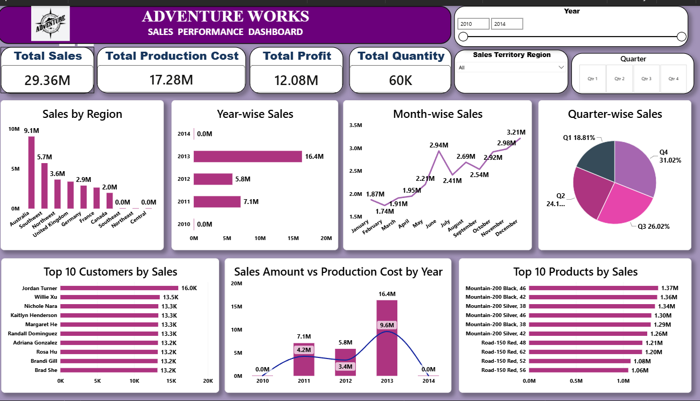
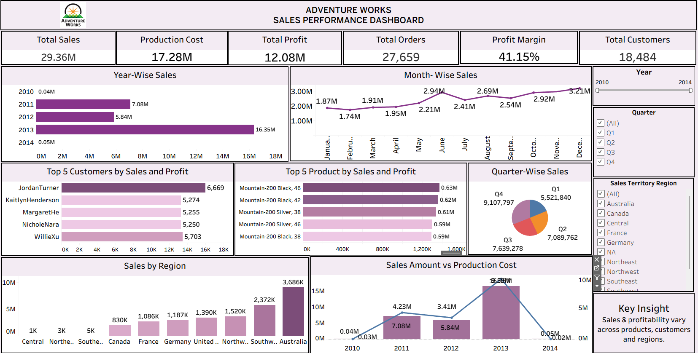
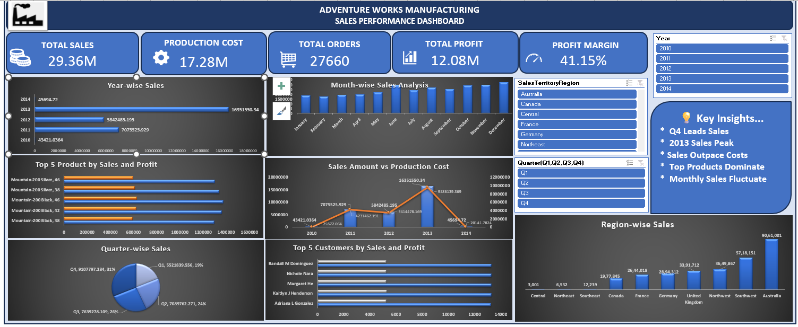

# AdventureWorks Sales Analysis

An end-to-end **Sales Data Analysis and Business Intelligence project** based on the AdventureWorks dataset.  
The project covers data cleaning, transformation, SQL analysis, Excel reporting, Power BI dashboarding, and Tableau visualization.

## Project Overview

The objective of this project is to transform raw AdventureWorks sales data into meaningful business insights using multiple data analytics and BI tools.

The project follows a complete analytics workflow:

**Raw Data → Data Cleaning → Data Transformation → SQL Analysis → Excel Analysis → Power BI Dashboard → Tableau Dashboard → Business Insights**

## Tools & Technologies

- **Microsoft Excel** – Data preparation, calculations, Pivot Tables and charts
- **Power Query** – Data cleaning, merging, transformation and calculated fields
- **SQL / MySQL** – Data querying, joins, union and business calculations
- **Power BI** – Interactive dashboard and KPI visualization
- **Tableau** – Interactive sales visualization and dashboard
- **Python / Data files** – Supporting project data preparation where applicable

## Dataset

The project uses AdventureWorks sales data containing:

### Fact Tables
- `FactInternetSales`
- `Fact_Internet_Sales_New`

### Dimension Tables
- `Dimcustomer`
- `DimDate`
- `DimProduct`
- `DimProductCategory`
- `DimProductSubCategory`
- `DimSalesterritory`

The project also contains cleaned versions of the datasets and CSV files prepared for SQL import.

## Data Cleaning & Preparation

The cleaned dataset includes the following preparation steps:

- Removed exact duplicate rows where applicable
- Trimmed unnecessary leading/trailing spaces
- Converted date fields into proper date formats
- Converted product price fields to numeric values
- Standardized selected column names
- Handled optional missing identifiers such as carrier tracking and customer PO numbers
- Preserved legitimate missing customer/product attributes instead of inventing values
- Prepared fact and dimension tables for analysis

The detailed cleaning notes are available in:

`cleaned_dataset/AdventureWorks_Cleaned_Dataset/README_Cleaning_Notes.txt`

## Assignment / Analysis Questions

The project implements the AdventureWorks questionnaire from **Q0 to Q13**.

### Q0 – Union of Sales Tables
Combined:

- `FactInternetSales`
- `Fact_Internet_Sales_New`

using a Union/Union All approach.

### Q1 – Product Lookup
Retrieved `ProductName` / `EnglishProductName` from the Product dimension and connected it with the Sales data.

### Q2 – Customer and Unit Price Lookup
Added:

- Customer Full Name
- Unit Price

using relationships/joins with Customer and Product tables.

### Q3 – Date Fields
Created date-related fields from `OrderDateKey`:

- Year
- Month Number
- Month Full Name
- Quarter
- Year-Month
- Weekday Number
- Weekday Name
- Financial Month
- Financial Quarter

### Q4 – Sales Amount
Calculated Sales Amount using the sales transaction fields, including unit price, order quantity and discount information.

### Q5 – Production Cost
Calculated / used Production Cost from the available product cost information and order quantity.

### Q6 – Profit
Calculated:

**Profit = Sales Amount − Production Cost**

### Q7 – Monthly Sales Pivot Table
Created a Pivot Table showing monthly sales with **Year as a filter**.

### Q8 – Year-wise Sales
Created a bar chart to compare sales across years.

### Q9 – Month-wise Sales
Created a line chart to analyze monthly sales trends.

### Q10 – Quarter-wise Sales
Created a pie chart to visualize sales distribution by quarter.

### Q11 – Sales Amount vs Production Cost
Created a combination chart using bars and a line to compare Sales Amount and Production Cost.

### Q12 – Additional Performance Analysis
Created additional KPIs/charts for performance analysis by:

- Product
- Customer
- Region

### Q13 – Final Dashboard
Created interactive dashboards to bring together KPIs, charts, filters and business insights in a single view.

## SQL Analysis

The SQL section contains queries for:

- Checking available tables
- Counting sales records
- Combining the two sales fact tables
- Looking up product names
- Looking up customer names and unit prices
- Converting `OrderDateKey` into a date
- Creating year/month/quarter and financial date fields
- Calculating Sales Amount
- Calculating Production Cost
- Calculating Profit

SQL file:

`Sql/Adventure_Works_SQL_Q0_Q6.sql`

## Power BI Dashboard

The Power BI report contains interactive visualizations for sales performance.

Main dashboard components include:

- Sales KPI
- Production Cost KPI
- Profit KPI
- Year-wise Sales
- Month-wise Sales
- Product performance
- Customer performance
- Regional performance
- Interactive Year filters / slicers

Power BI file:

`Power_bi/Final Power BI Project.pbix`

### Power BI Dashboard Preview



## Tableau Dashboard

A Tableau workbook is included for interactive visualization and comparison of sales performance.

Tableau file:

`Tableau/Tableau Adv.Project.twbx`

### Tableau Dashboard Preview



## Excel Dashboard

Excel was used for data analysis, Pivot Tables, calculations and dashboard creation.

Excel project file:

`excel/Adventure Works Manufacturing - Excel Week 1 - Q0 to Q13.xlsx`

### Excel Dashboard Preview



## Project Structure

```text
Adventure_work/
│
├── cleaned_dataset/
│   └── AdventureWorks_Cleaned_Dataset/
│       ├── FactInternetSales_Cleaned.xlsx
│       ├── Fact_Internet_Sales_New_Cleaned.xlsx
│       ├── Dimcustomer_Cleaned.xlsx
│       ├── DimDate_Cleaned.xlsx
│       ├── DimProduct_Cleaned.xlsx
│       ├── DimProductCategory_Cleaned.xlsx
│       ├── DimProductSubCategory_Cleaned.xlsx
│       ├── DimSalesterritory_Cleaned.xlsx
│       ├── Questionnaires_Cleaned.xlsx
│       └── README_Cleaning_Notes.txt
│
├── CSV.files for sql import/
│   ├── FactInternetSales_Cleaned.csv
│   ├── Fact_Internet_Sales_New_Cleaned.csv
│   ├── Dimcustomer_Cleaned.csv
│   ├── DimDate_Cleaned.csv
│   ├── DimProduct_Cleaned.csv
│   ├── DimProductCategory_Cleaned.csv
│   ├── DimProductSubCategory_Cleaned.csv
│   └── DimSalesterritory_Cleaned.csv
│
├── dataset/
│   └── AdventureWorks Datasets/
│       ├── FactInternetSales.xlsx
│       ├── Fact_Internet_Sales_New.xlsx
│       ├── Dimcustomer.xlsx
│       ├── DimDate.xlsx
│       ├── DimProduct.xlsx
│       ├── DimProductCategory.xlsx
│       ├── DimProductSubCategory.xlsx
│       ├── DimSalesterritory.xlsx
│       └── Questinaires.xlsx
│
├── excel/
│   └── Adventure Works Manufacturing - Excel Week 1 - Q0 to Q13.xlsx
│
├── Power_bi/
│   └── Final Power BI Project.pbix
│
├── Sql/
│   └── Adventure_Works_SQL_Q0_Q6.sql
│
├── Tableau/
│   └── Tableau Adv.Project.twbx
│
├── screen_shot/
│   ├── Excel_dashboard.png
│   ├── Power_bi_dashboard.png
│   └── Tableau_dashboard.png
│
└── AdventureWorks_Sales_Analysis...pptx
```

## Key Business Insights

The dashboards are designed to help analyze:

- Overall sales performance
- Profitability
- Sales trends over time
- Product performance
- Customer contribution
- Regional performance
- Quarterly and monthly sales patterns
- Relationship between sales amount and production cost

## How to Use the Project

### 1. Excel
Open the Excel workbook from:

`excel/`

Review the calculations, Pivot Tables, charts and dashboard.

### 2. SQL
Import the cleaned CSV files from:

`CSV.files for sql import/`

Then run the queries from:

`Sql/Adventure_Works_SQL_Q0_Q6.sql`

### 3. Power BI
Open:

`Power_bi/Final Power BI Project.pbix`

Refresh the data source if required and use the slicers/interactions to explore the dashboard.

### 4. Tableau
Open:

`Tableau/Tableau Adv.Project.twbx`

If Tableau reports a data-path issue on another computer, update the workbook's data connection to the local dataset location.

## Project Outcome

This project demonstrates an end-to-end understanding of:

- Data cleaning
- Data transformation
- Data integration
- SQL joins and calculations
- Excel analysis
- KPI creation
- Business intelligence dashboards
- Data visualization
- Business-oriented sales analysis

## Author

**Arti Wakde**

Data Analytics / Business Intelligence Project

---
